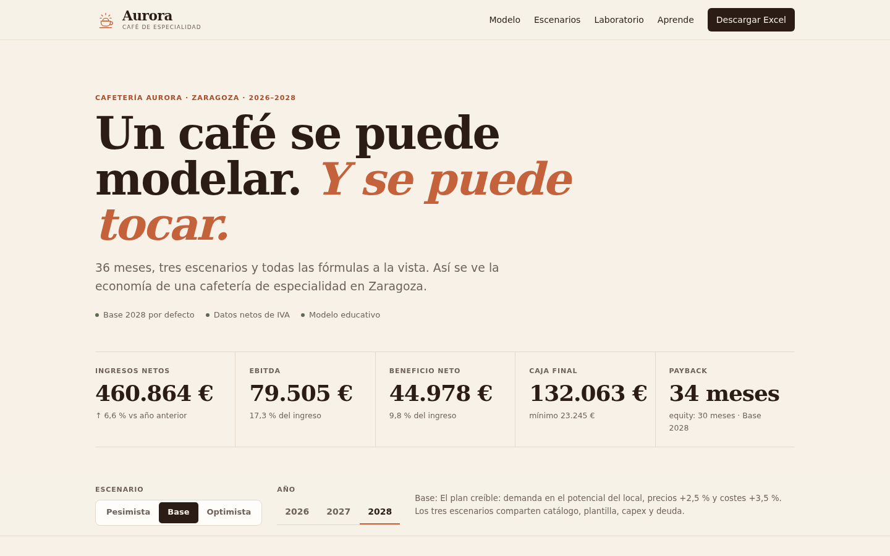

<p align="center">
  
</p>

<h1 align="center">Cafetería Aurora — Modelo financiero a 3 años</h1>

<p align="center">
  Un modelo financiero editable, un dashboard que se puede tocar y una guía para aprender finanzas con el caso.
</p>

<p align="center">
  <a href="https://gerrcass.github.io/analisis-financiero-cafeteria/"><strong>Ver el dashboard</strong></a>
  ·
  <a href="https://gerrcass.github.io/analisis-financiero-cafeteria/aprende.html"><strong>Leer la guía</strong></a>
  ·
  <a href="https://gerrcass.github.io/analisis-financiero-cafeteria/assets/Cafeteria-Aurora-Modelo-Financiero.xlsx"><strong>Descargar el Excel</strong></a>
</p>



## Qué es esto

Cafetería Aurora es un café de especialidad de barrio en Zaragoza. Este repositorio modela su economía mes a mes durante **36 meses (2026–2028)** en tres escenarios —**Pesimista**, **Base** y **Optimista**— y entrega tres formas de entenderla:

1. **Un libro Excel** con diez hojas, fórmulas vivas, gráficos y una hoja de aprendizaje. Cambias un supuesto y todo se recalcula.
2. **Un sitio estático** con dashboard, selector de escenario, detalle de producto, costes, punto de equilibrio, un laboratorio de supuestos y la guía.
3. **Una guía de finanzas** en español que usa las cifras reales del caso para explicar de dónde sale cada euro, cómo se pasa del beneficio a la caja y qué errores invalidan un modelo.

La fuente única de verdad es `data/model.json`. El libro, el sitio, los tests y los objetivos dorados se derivan de ese contrato.

## El caso en una mirada

| | |
|---|---|
| Inversión inicial | 160.000 € (132.000 € de capex, 6.500 € de stock y 21.500 € de caja) |
| Financiación | 90.000 € de equity + 70.000 € de préstamo al 7,5% a 5 años |
| Demanda | 360 tickets/día en régimen, rampa de 6 meses, 312 días operativos |
| Catálogo | 8 productos, mix 22/20/10/13/8/14/9/4 |
| Equipo | 3,5 FTE en 2026 → 4,0 FTE en 2027–2028 |
| Base 2026 | 384.419 € de ingresos, 61.658 € de EBITDA (16,0%), 30.142 € de beneficio neto |
| Base 2028 | 460.864 € de ingresos, 79.505 € de EBITDA (17,3%), 132.063 € de caja |
| Payback Base | 34 meses de proyecto / 30 meses de equity |
| Pesimista | 378.796 € de ingresos en 2028, 134 € de beneficio neto, payback >36 meses |

Las cifras están netas de IVA. El brief completo, con la matriz de escenarios, las fórmulas y los objetivos dorados, está en [`docs/project-brief.md`](docs/project-brief.md).

## El libro Excel

El archivo se genera desde el contrato y se descarga desde el sitio:

**[Cafeteria-Aurora-Modelo-Financiero.xlsx](docs/assets/Cafeteria-Aurora-Modelo-Financiero.xlsx)**

| Hoja | Para qué sirve |
|---|---|
| Portada | Identidad, instrucciones, leyenda y versión |
| Resumen | KPIs, comparativa de escenarios, retorno y cinco gráficos vivos |
| Supuestos | Demanda, estacionalidad, rampa, matriz de escenarios, fiscalidad y financiación |
| Productos | PVP, IVA, precio neto, coste, mix, merma y margen |
| Personal | Roles, FTE por año, salarios y coste empresa |
| Costos | Alquiler, suministros, servicios, marketing, otros gastos, capex y deuda |
| Pesimista | Modelo mensual del escenario de estrés |
| Base | Modelo mensual del plan |
| Optimista | Modelo mensual del escenario de expansión |
| Aprende | Guía resumida, fórmulas clave, glosario y errores comunes |

**Regla de oro:** las únicas celdas escritas a mano son los supuestos de las cuatro hojas de entrada (y los metadatos de Portada). Todo lo demás es una fórmula que se recalcula al abrir el archivo.

## El sitio

- Dashboard con hero, KPIs, ingresos/EBITDA, caja/deuda, unit economics, estructura de costes, punto de equilibrio, cuenta de resultados y descarga.
- Selector de escenario y año con estado en la URL.
- Laboratorio de supuestos: mueve demanda, precios, costes o personal y observa el delta frente al escenario original.
- Guía de diez capítulos con ejemplos, 36 ejercicios, glosario y checklist de validación.
- Sin backend, sin CDN, sin dependencias de runtime.

## Cómo regenerar

Requisitos: Python 3.10+, Node.js 22+ y `make`.

```bash
make setup      # crea .venv e instala dependencias de test
make model      # regenera data/expected.json desde data/model.json
make workbook   # regenera el libro Excel
make site       # construye el sitio en docs/
make test       # tests Python, Node, libro y navegador
make check      # construye, testea y verifica que docs/ está actualizado
make serve      # sirve docs/ en http://localhost:8000
```

El flujo es intencionadamente unidireccional:

```text
data/model.json
      │
      ├──► scripts/model.py ──────► data/expected.json
      │                                  │
      ├──► scripts/build_workbook.py ────┤
      │                                  │
      └──► site/js/model.js ─────────────┘
                     │
                     └──► scripts/build_site.py ──► docs/ ──► GitHub Pages
```

No se edita a mano ni el libro ni el sitio construido. Si un test detecta que `docs/` no coincide con la fuente, se regenera y se commitea el artefacto.

## Calidad

- **Contrato**: mix 100%, estacionalidad 12,00, 312 días operativos, fuentes = usos, escenarios ordenados.
- **Motor**: Python y JavaScript reproducen los objetivos dorados con tolerancia ±1 € / ±0,1 pp.
- **Libro**: auditoría de fórmulas, recalculación, diez hojas, cinco gráficos con rangos vivos y cero errores de fórmula.
- **Sitio**: tests de motor, extremo a extremo, responsive, teclado y descarga.
- **Contenido**: diez capítulos, 36 ejercicios, cifras clave contrastadas contra los objetivos dorados.

Los tests son la garantía de que "fórmulas vivas" no es una promesa de marketing. La auditoría recorre las celdas calculadas y falla si encuentra un valor pegado.

## Estructura del repositorio

```text
data/                 contrato de supuestos y objetivos dorados
scripts/              motores, generadores y recalculación
site/                 fuente del sitio (HTML, CSS, JS, SVG)
docs/                 sitio construido + documentación + Excel descargable
docs/project-brief.md contrato congelado de supuestos, fórmulas y objetivos
docs/adr/             decisiones de arquitectura
docs/guia-finanzas.md guía canónica de aprendizaje
tests/                Python, Node y navegador
```

## Documentación

- [Brief del proyecto y libro de supuestos](docs/project-brief.md)
- [Especificación de implementación](docs/specs/001-modelo-financiero-cafeteria.md)
- [Glosario de dominio](GLOSSARY.md)
- [Decisiones de arquitectura](docs/adr/)
- [Guía de finanzas](docs/guia-finanzas.md)
- [Estándares de código](CODING_STANDARDS.md)
- [Benchmarks del sector](docs/research/benchmarks.md)
- [Dirección visual](docs/design-brief.md)

## Aviso

Este es un **modelo educativo** construido con supuestos ilustrativos. No es asesoramiento financiero, fiscal, legal ni una previsión de demanda de un local concreto. Antes de invertir, valida tickets/día con un conteo real, pide tres presupuestos de capex y negocia el alquiler con datos.

---

Hecho con [T3 Code](https://t3.codes). El modelo, el sitio y la guía se construyeron siguiendo el flujo de trabajo de [Matt Pocock](https://github.com/mattpocock/skills).
